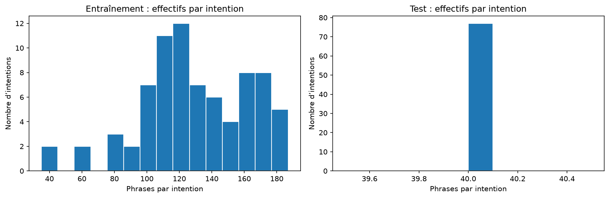
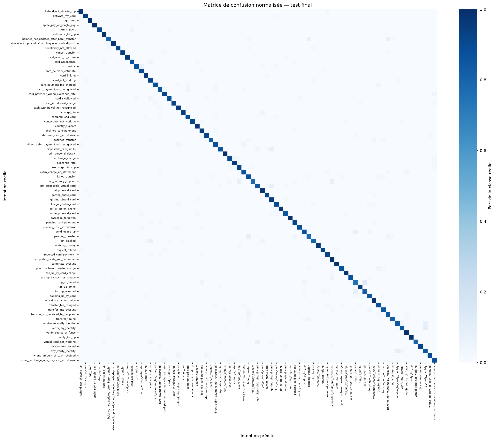
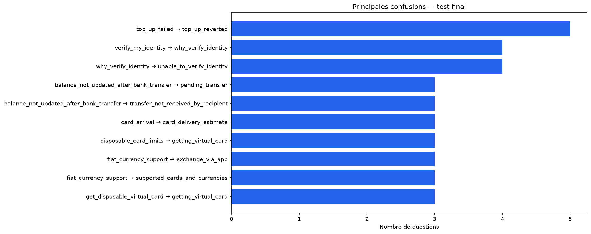

# Classification d’intentions bancaires — rapport final

## Objectif et données

Le système associe une question bancaire en anglais à l’une des 77 intentions Banking77, puis à une réponse préenregistrée de démonstration. Aucun texte bancaire n’est généré par le classifieur.

Les fichiers fournis contiennent 10003 exemples d’entraînement et 3080 exemples de test. Après normalisation, 24 lignes communes au test, 2 lignes aux étiquettes contradictoires et 27 doublons internes ont été retirés de l’entraînement. Les variantes d’une même question associées à plusieurs intentions sont toutes exclues plutôt qu’arbitrées. L’entraînement final contient 9950 lignes ; le test fourni reste inchangé (3080 lignes).

*Figure 1 — Distribution du nombre de phrases par intention.* Les effectifs varient selon l’intention dans l’entraînement, tandis que le test est équilibré avec 40 phrases par intention. La F1 macro complète l’accuracy en donnant le même poids à chaque classe.

## Prétraitement et protocole

La normalisation applique Unicode NFKC, les minuscules, l’unification des apostrophes, la réduction des espaces et le dictionnaire contrôlé `variantes.json`. Les contractions négatives sont développées sans suppression de la négation. La ponctuation est conservée. Aucun dictionnaire n’est appris sur le test.

La validation est une séparation stratifiée de 20 % de l’entraînement nettoyé, avec une graine de 42 : 7960 exemples de travail et 1990 de validation. Le vocabulaire, l’IDF et la projection LSA sont appris exclusivement sur l’entraînement de travail pendant la comparaison. Le contrôle préalable des doublons utilise uniquement le texte du test, sans ses étiquettes. Le choix des paramètres repose sur la F1 macro de validation ; le test n’intervient pas dans ce choix.

## Représentations et classification

La référence lexicale combine TF-IDF de mots (1–2 grammes) et de caractères (3–5 grammes). Les embeddings denses utilisent le moteur **lsa**, avec **256 dimensions**. En mode LSA, la SVD tronquée capture une structure latente de cooccurrence propre au corpus ; il s’agit d’embeddings non contextuels, distincts de Sentence-BERT. Le mode hybride concatène les caractéristiques lexicales et les embeddings normalisés, pondérés par 0,5. Le classifieur est un SVM linéaire.

Les valeurs de C comparées sont 0,5, 1 et 3. Le modèle livré inclut des embeddings, conformément à l’objectif de représentation dense ; TF-IDF seul sert de référence. Le modèle retenu est **hybride**, avec **C = 0.5**. Sa F1 macro de validation (0.9083) est supérieure à la meilleure référence TF-IDF (0.9057).

| mode | C | accuracy | precision_macro | rappel_macro | f1_macro |
| --- | --- | --- | --- | --- | --- |
| hybride | 0.5 | 0.9106 | 0.9124 | 0.9086 | 0.9083 |
| tfidf | 0.5 | 0.908 | 0.9098 | 0.9062 | 0.9057 |
| tfidf | 1.0 | 0.9075 | 0.9085 | 0.9053 | 0.9049 |
| hybride | 1.0 | 0.9065 | 0.9081 | 0.9047 | 0.9043 |
| hybride | 3.0 | 0.9045 | 0.9054 | 0.9024 | 0.9017 |
| tfidf | 3.0 | 0.9035 | 0.9045 | 0.9009 | 0.9004 |
| embeddings | 1.0 | 0.8874 | 0.8926 | 0.8862 | 0.8872 |
| embeddings | 0.5 | 0.8844 | 0.8918 | 0.8802 | 0.8822 |
| embeddings | 3.0 | 0.8819 | 0.8851 | 0.8804 | 0.8808 |

Les embeddings seuls obtiennent une F1 macro de validation de 0.8872, contre 0.9057 pour la référence lexicale. La projection dense compresse les informations disponibles ; les termes et séquences de caractères précis restent utiles pour distinguer des intentions proches. La représentation retenue présente un écart de +0.27 point de F1 macro par rapport à la référence. Cette mesure repose sur une seule séparation de validation et ne démontre pas à elle seule un gain statistiquement significatif.

## Évaluation finale

Après sélection, le pipeline est réentraîné sur tout l’entraînement nettoyé. Le test contient 40 exemples par intention. L’accuracy et le rappel macro coïncident donc. La F1 macro donne le même poids à chacune des 77 intentions ; elle permet de compléter l’accuracy par une mesure tenant compte de la précision et du rappel par classe.

| accuracy | precision_macro | rappel_macro | f1_macro |
| --- | --- | --- | --- |
| 0.9084 | 0.9111 | 0.9084 | 0.9084 |

Le modèle commet **282 erreurs sur 3080 questions**, soit **9.16%**. Le rapport complet par classe est disponible dans `artifacts/rapport_classification.csv`.

### Intentions les plus difficiles

| intention | precision | recall | f1-score | support |
| --- | --- | --- | --- | --- |
| top_up_failed | 0.769 | 0.75 | 0.759 | 40.0 |
| pending_transfer | 0.795 | 0.775 | 0.785 | 40.0 |
| balance_not_updated_after_bank_transfer | 0.8 | 0.8 | 0.8 | 40.0 |
| failed_transfer | 0.761 | 0.875 | 0.814 | 40.0 |
| card_not_working | 0.755 | 0.925 | 0.831 | 40.0 |
| transfer_not_received_by_recipient | 0.829 | 0.85 | 0.84 | 40.0 |
| why_verify_identity | 0.829 | 0.85 | 0.84 | 40.0 |
| top_up_reverted | 0.868 | 0.825 | 0.846 | 40.0 |

### Matrice de confusion

*Figure 2 — Matrice de confusion normalisée par intention réelle.* Chaque ligne correspond à la classe réelle et chaque colonne à la classe prédite. La diagonale concentre les classifications correctes ; les cellules hors diagonale montrent les confusions entre intentions.

### Confusions observées

| vrai | predit | nombre |
| --- | --- | --- |
| top_up_failed | top_up_reverted | 5 |
| verify_my_identity | why_verify_identity | 4 |
| why_verify_identity | unable_to_verify_identity | 4 |
| balance_not_updated_after_bank_transfer | pending_transfer | 3 |
| balance_not_updated_after_bank_transfer | transfer_not_received_by_recipient | 3 |
| card_arrival | card_delivery_estimate | 3 |
| disposable_card_limits | getting_virtual_card | 3 |
| fiat_currency_support | exchange_via_app | 3 |
| fiat_currency_support | supported_cards_and_currencies | 3 |
| get_disposable_virtual_card | getting_virtual_card | 3 |

*Figure 3 — Principales confusions, en nombre de questions.* Chaque barre représente une confusion de l’intention réelle vers l’intention prédite. Ce graphique détaille les erreurs les plus fréquentes, moins faciles à repérer dans la matrice complète à 77 classes.

La confusion la plus fréquente relie `top_up_failed` à `top_up_reverted` (5 cas). Les catégories concernant les virements en attente, les délais et les fonds non reçus partagent un vocabulaire proche. De même, une demande de carte physique, sa commande et sa livraison décrivent des étapes voisines. Les prédictions erronées exportées dans `artifacts/erreurs_test.csv` permettent une inspection phrase par phrase. Ces observations décrivent les erreurs ; elles ne servent pas à modifier les paramètres après l’évaluation finale.

## Application et livrables

L’interface Streamlit charge le pipeline complet, applique le même nettoyage qu’à l’entraînement et présente l’intention prédite avec une réponse spécifique. Le fichier `reponses.json` couvre exactement les 77 intentions, y compris leurs étiquettes originales. Les réponses sont pédagogiques et ne constituent pas les procédures d’une banque réelle.

Le notebook contient l’exploration, la comparaison sur validation, la génération des embeddings, l’évaluation, les visualisations et une démonstration. Le dossier `artifacts/` contient le pipeline, les matrices d’embeddings avec leurs étiquettes, les indices de validation, les prédictions, les métriques, les rapports CSV et les figures. Les versions des bibliothèques, la graine et les empreintes SHA-256 des données sont consignées dans `artifacts/metriques.json`.

## Limites et prolongements

Les résultats portent sur des questions en anglais issues de Banking77. Le système impose une intention bancaire même pour une requête hors domaine : aucun rejet hors domaine ni score de probabilité calibré n’est implémenté. Les marges du SVM ne sont pas présentées comme des probabilités. Les formulations ambiguës et les intentions voisines restent une source d’erreurs. Les résultats ne constituent pas une estimation de performance sur d’autres langues ou d’autres banques.

Le mode LSA fonctionne sans téléchargement. L’option Sentence-BERT utilise `sentence-transformers/all-MiniLM-L6-v2` et nécessite les dépendances optionnelles ainsi qu’un premier accès réseau ; les poids sont ensuite conservés dans `artifacts/sentence_bert/`. Son état d’exécution dans cette expérience est **False**. Aucun score Sentence-BERT n’est annoncé sans exécution correspondante. Si la consigne exige spécifiquement un encodeur préentraîné, l’exécution de cette option reste nécessaire ; la livraison locale utilise des embeddings LSA.

## Références

- [Banking77 — publication et données originales](https://github.com/PolyAI-LDN/task-specific-datasets/tree/master/banking_data) ; les fichiers locaux fournis servent de référence pour cette expérience.
- [Scikit-learn — analyse sémantique latente et SVD tronquée](https://scikit-learn.org/stable/modules/decomposition.html#truncated-singular-value-decomposition-and-latent-semantic-analysis).
- [Sentence Transformers — génération d’embeddings](https://sbert.net/docs/sentence_transformer/usage/usage.html).
- [Fiche du modèle all-MiniLM-L6-v2](https://huggingface.co/sentence-transformers/all-MiniLM-L6-v2).
